<p align="center">
  
</p>

<h1 align="center">TWS Pipeline Harness</h1>

<p align="center">
  <b>Every red build, rerouted. A human on the signal.</b><br>
  A failed GitHub Actions run goes in. A runbook-backed, minimal fix PR comes out.<br>
  Nothing merges until an authorized approver clears the signal. Temporal keeps every run alive.
</p>

<p align="center">
  
  
  
  
  
</p>

<p align="center">
  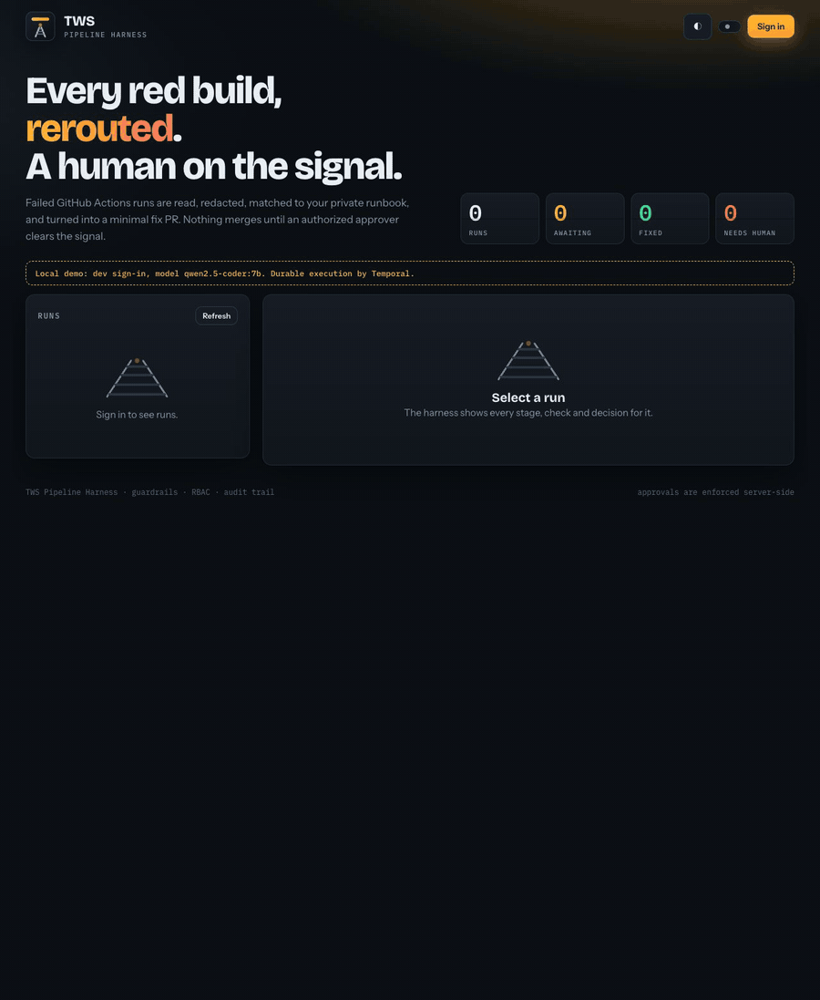<br>
  <sub><b>A real run, not mock data.</b> Real GitHub, <code>qwen2.5-coder:7b</code> on Ollama, Temporal, two different people. The model's several-minute wait is sped up.</sub>
</p>

---

## Run it in two minutes (any machine with Docker)

You need Docker, `curl`, `openssl`, and a **public sandbox repo on your GitHub** with a fine-grained token scoped to it.

```bash
gh repo create <you>/ci-sandbox --public          # or create it in the GitHub UI
git clone https://github.com/TrainWithShubham/github-actions-ci-analyzer && cd github-actions-ci-analyzer
./start_local.sh --fast         # first run asks for the repo and the token; --fast = no model download
./start_local.sh seed           # breaks the sandbox repo on purpose and finds the failed CI run
```

Open <http://localhost:8080>:

1. **Sign in as Alice** (admin) and press **Analyze failure** (repo and run id are prefilled).
2. Watch the stages light up. Open the **Temporal UI** at <http://localhost:8233> to see the workflow history.
3. **Sign out, sign in as Bob** (approver). Try approving as Alice first: refused, you cannot approve your own run. Bob approves, the PR merges, CI runs again and goes green.
4. **Durability:** `./start_local.sh chaos` kills the worker mid-run and brings it back. The run finishes anyway.

Want a real model instead of the scripted one? Drop `--fast`: it pulls `qwen2.5-coder:7b` through Ollama (about 5 GB; `--small` uses the 3B; `--gpu` for NVIDIA).
Token permissions, rotation and troubleshooting: [`docs/OPERATIONS.md`](docs/OPERATIONS.md).

> **Public means public.** The branches, PRs and CI logs the agent creates in your sandbox repo are visible to everyone. Use a throwaway repo.

## Why this exists

CI breaks for boring reasons: a missing script, an unpinned dependency, a deprecated action. Fixing them is toil, and letting an LLM push to your repos
unattended is a bad idea. This project is the middle path, built as a **harness**: the model is one replaceable part, everything that makes the result
safe is deterministic code around it, and **Temporal** makes the whole run durable.

## Harness engineering: the model is the least trusted part

> *Agent = model + harness.* The model proposes. The harness decides what is allowed to happen.

| Layer | What it does here | Code |
|---|---|---|
| **Guides** (feed-forward) | Logs declared untrusted. The runbook is the only source of fix authority. The model sees the current file and must answer in a strict find/replace schema. | `steps.py` |
| **Sensors** (feedback) | Secret redaction. The citation must match a *retrieved* runbook source. Edits must match exactly once. Max 1 removed line. Repo / branch / path / size policy. Optional Bedrock Guardrails (AWS profile). | `guard/`, `steps.py` |
| **Computed truth** | The server applies the edits and computes the diff and its hash. Model-written diffs are discarded. | `steps.py` |
| **Gate** | The workflow waits for a decision. Approval needs a verified JWT, the `approver`/`admin` role, a different person than the triggerer, and the exact diff hash. | `temporal/workflows.py`, `auth/` |
| **Durable execution** | Every step is a Temporal activity with its own retry policy and timeout. The run, its state and its human wait survive any crash. | `temporal/` |
| **Fail closed** | Guard block, no runbook match, bad JSON, policy violation, GitHub 4xx: the run ends as `needs_human` and any open PR is closed. Never an unreviewed merge. | everywhere |

### What Temporal adds

| Without it (earlier design: LangGraph checkpoints) | With it |
|---|---|
| A crash mid-run lost the run unless someone re-invoked it | The run resumes on any worker, exactly where it stopped |
| The HTTP request ran the whole agent | The API returns at once; the workflow runs on its own |
| A GitHub 502 or model hiccup failed the node | Per-step retries with backoff; permanent errors stop immediately |
| Approval could wait forever | A deadline closes the PR and ends the run as `needs_human` |
| A bad approval attempt ended the run | The attempt is refused and audited; the run keeps waiting for a valid approver |
| State in a DynamoDB checkpointer plus a run index plus an audit table | One workflow history (encrypted), with search attributes for listing |

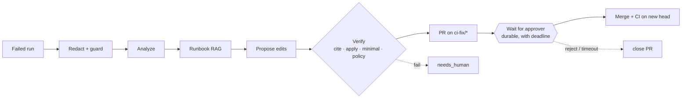

More diagrams, the approval sequence and design decisions: [`docs/ARCHITECTURE.md`](docs/ARCHITECTURE.md).

### What building it taught us (each became a test)

| What went wrong | Control it produced |
|---|---|
| A small model rewrote `package.json`, renamed the package and deleted the `test` script | Model returns edits; **server** applies and diffs; removed-lines cap |
| The "diff" the model reported was its own description of its change | Diff and hash computed server-side |
| The model cited `## Missing build script` (with hashes) and the runtime failed to match | Citation normalized **and** verified against retrieved text |
| An approver in a second AgentCore session saw nothing: sessions are isolated per identity | State moved out of the process (now Temporal) |
| GitHub's "re-run" replays the **original** commit, so it fails again with the old code. Found by the live test | After merge, dispatch a fresh run on the branch |
| A first seed picked a run that was rejected at parse time and had no jobs | Seeding picks a run with a failed job, after all runs finish |

## See it work (real screenshots of the running stack)

Captured by `scripts/capture_demo.py` driving a real browser against `./start_local.sh`: real GitHub sandbox repo, `qwen2.5-coder:7b` via Ollama, Temporal.

<table>
<tr>
<td width="50%">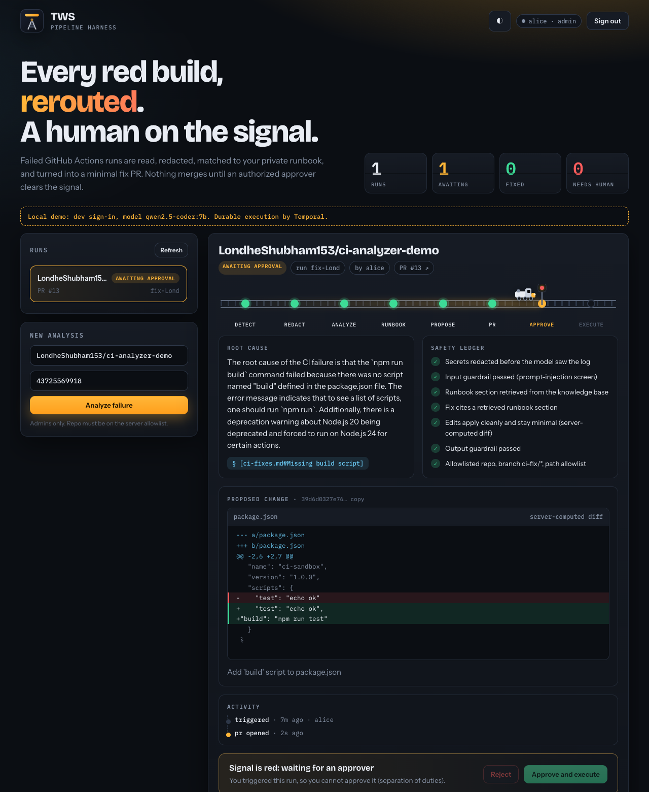<br><sub><b>1. The signal is red.</b> Root cause, safety ledger, the server-computed diff and its hash. Alice triggered this run, so her Approve button is disabled (separation of duties).</sub></td>
<td width="50%">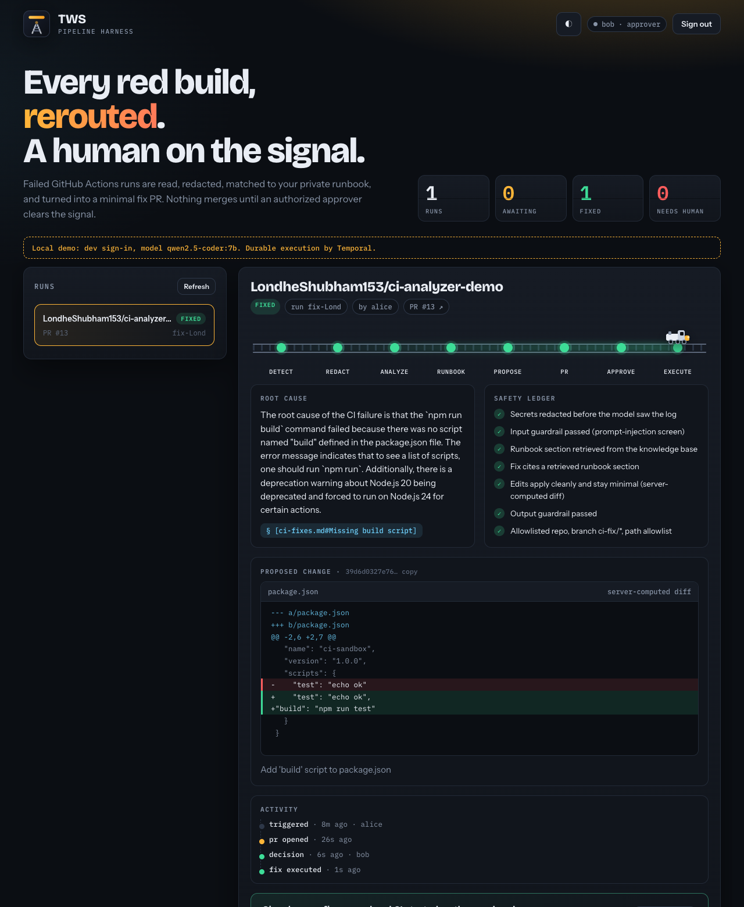<br><sub><b>2. Bob approves, the PR merges, CI starts on the new head.</b> The train reaches Execute; the audit trail records who decided.</sub></td>
</tr>
<tr>
<td>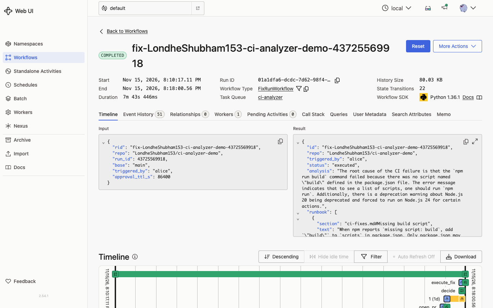<br><sub><b>3. The same run in Temporal.</b> Input and result are decoded locally from encrypted history. Duration, state transitions and the timeline show the 7 minutes the model took and the human wait.</sub></td>
<td>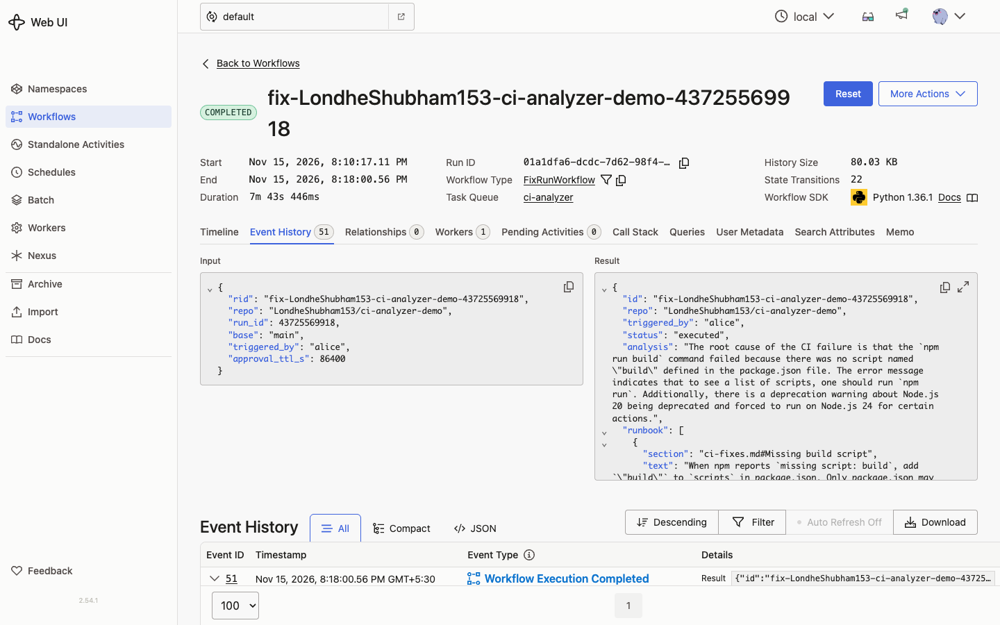<br><sub><b>4. Every step is an event.</b> Activities, retries, the approval update and the completion are all in the history.</sub></td>
</tr>
<tr>
<td>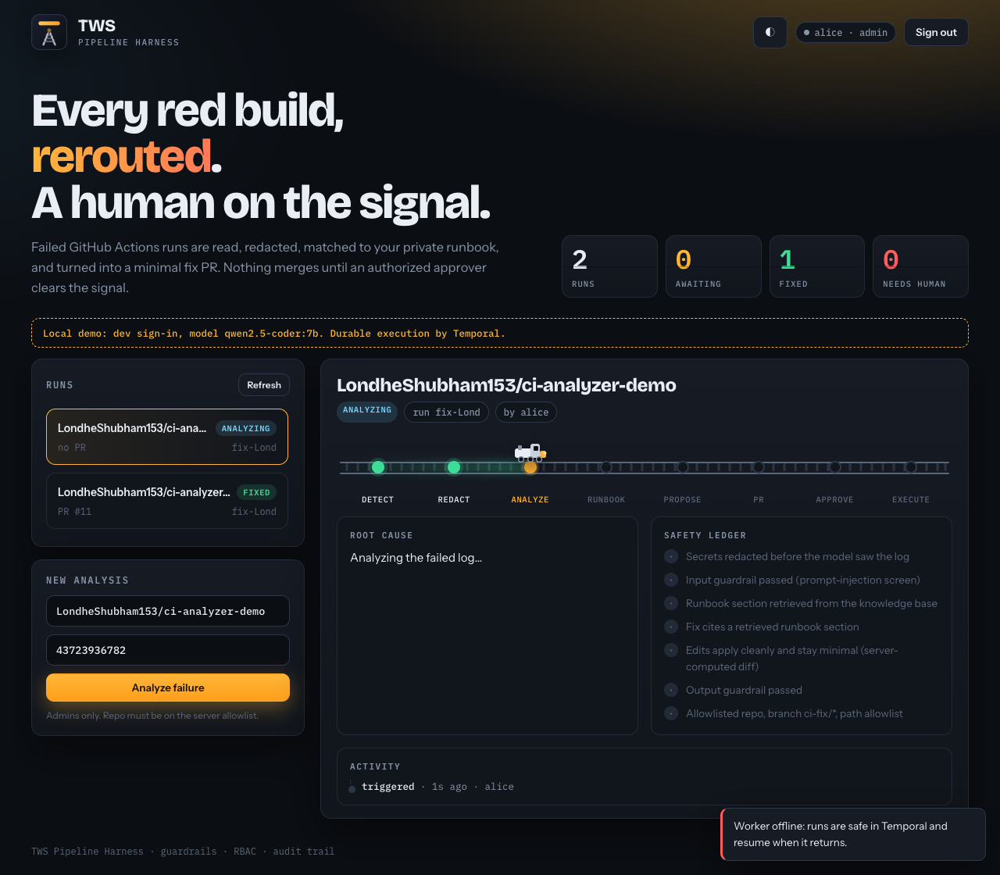<br><sub><b>5. Kill the worker mid-run.</b> The app says so and keeps the run: it is stored in Temporal, not in the process.</sub></td>
<td>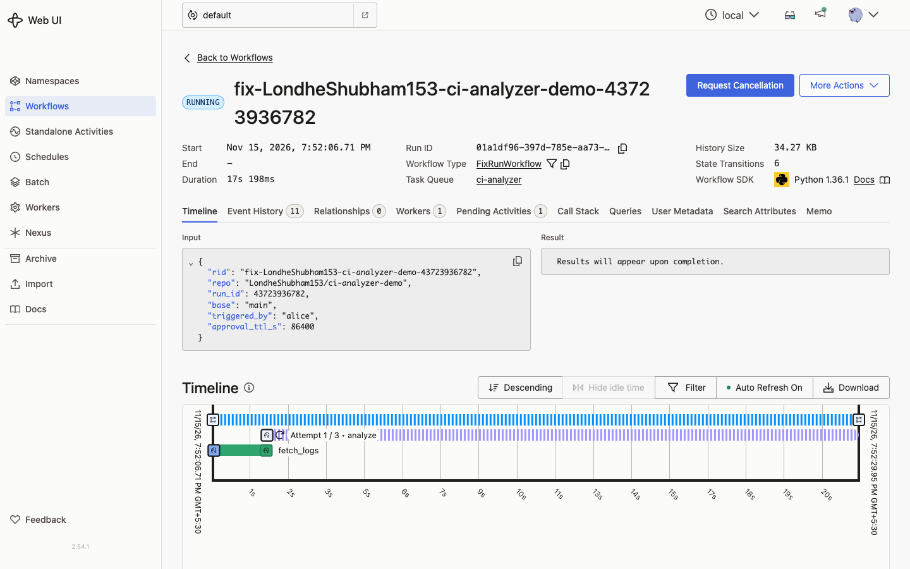<br><sub><b>6. Temporal is waiting for a worker.</b> One pending activity (<code>analyze</code>, attempt 1 of 3). Restart the worker and it resumes.</sub></td>
</tr>
<tr>
<td>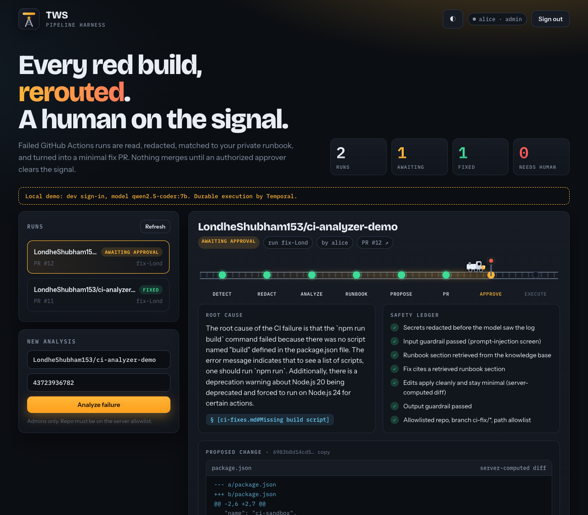<br><sub><b>7. Resumed.</b> The run carried on from where it stopped and reached the approval gate.</sub></td>
<td>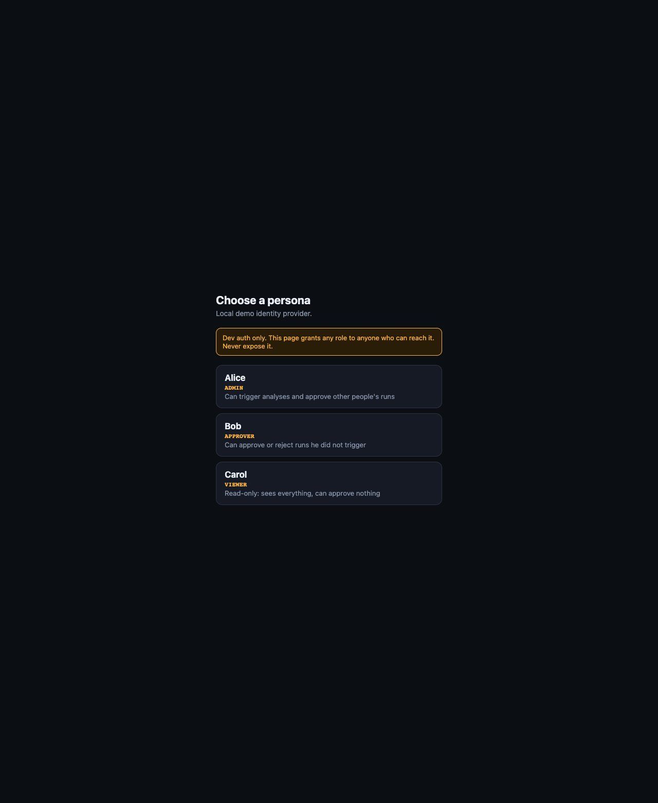<br><sub><b>Sign-in</b> through the local OIDC issuer (PKCE). Pick Alice (admin), Bob (approver) or Carol (viewer). Demo only.</sub></td>
</tr>
</table>

### An honest note about small models

On this laptop (CPU only) the 3B model twice produced edits that broke `package.json` (a duplicated key, a missing comma). The harness refused both, even after
one retry that told the model why, so the run ended as `needs_human` and nothing was merged. The 7B model produced a valid fix, but with sloppy indentation
(`"build": "npm run test"`). It is valid JSON and the runbook allows it, so it passes; a human reviewing the diff would likely ask for tidier output.
That is the point of the gate. Use a stronger model (`MODEL=...`) for better diffs.

## The UI (sample-data gallery)

A railway control room: the pipeline is a track, each stage a station, and the approval is the signal gate.

<table>
<tr>
<td width="50%"><br><sub><b>Stopped safely.</b> The policy rejected a fix that removed too many lines. No PR was opened.</sub></td>
<td width="50%"><br><sub><b>Fixed.</b> Approved by a different user, merged, CI started on the new head, every step in the audit trail.</sub></td>
</tr>
<tr>
<td>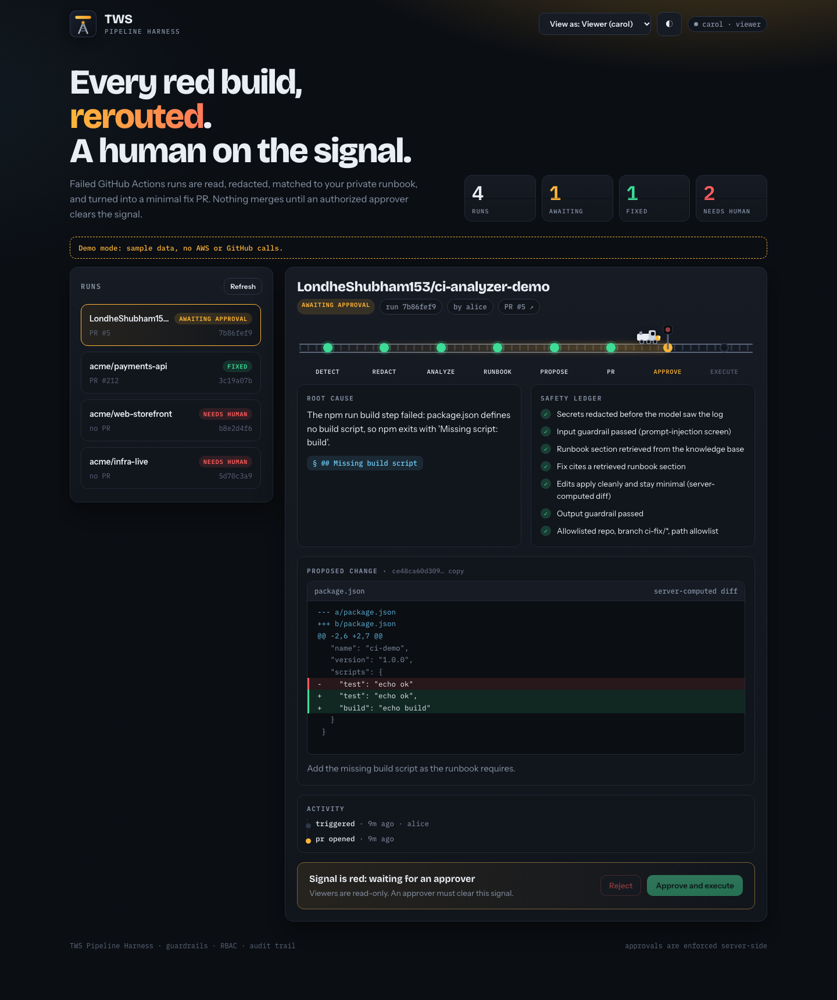<br><sub><b>RBAC in the UI.</b> A viewer sees everything and can approve nothing. The server enforces it regardless.</sub></td>
<td><br><sub><b>Light theme</b>, same harness. Respects <code>prefers-color-scheme</code> and <code>prefers-reduced-motion</code>.</sub></td>
</tr>
<tr>
<td><br><sub><b>Confirm with the diff hash.</b> Approval is bound to the exact change.</sub></td>
<td align="center">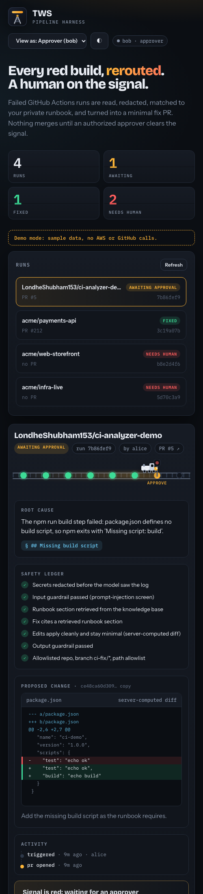<br><sub><b>Mobile.</b></sub></td>
</tr>
</table>

<sub>Screenshots use the built-in demo mode (<code>?demo=1</code>): sample data, no services. The live stack looks the same.</sub>

## Develop

```bash
make install
make test          # in-process Temporal dev server + fakes: no Docker, no GitHub, no model
make lint
make demo          # UI with sample data, no backend: http://localhost:8777/?demo=1
make local         # the full stack (same as ./start_local.sh)
```

## API

One endpoint, because AgentCore forwards only `/invocations` and `/ping` (the AWS profile keeps that contract). Every call needs `Authorization: Bearer <access token>`.

```http
POST /invocations
{"action": "trigger",  "repo": "owner/repo", "run_id": 123}        # admin. Returns at once; the workflow runs on its own
{"action": "list"}                                                  # any role
{"action": "get",      "id": "<workflow id>"}
{"action": "audit",    "id": "<workflow id>"}
{"action": "decision", "id": "<workflow id>", "approved": true, "diff_hash": "<hash>"}   # approver/admin, not the triggerer
```

| Role | read | approve | trigger |
|---|:-:|:-:|:-:|
| viewer | ✓ | | |
| approver | ✓ | ✓ | |
| admin | ✓ | ✓ | ✓ |

Responses: `401` no/invalid token, `403` not permitted (including self-approval, wrong diff hash), `409` duplicate run or not awaiting approval, `503` worker unreachable.
A run list entry with `"stale": true` means the worker is offline: the run is safe in Temporal and the state shown is the last known one.

## Configuration

| Variable | Default | Meaning |
|---|---|---|
| `DEMO_REPO` | none | `owner/repo` sandbox; also the only repo the agent may touch (`GITHUB_REPO_ALLOWLIST`) |
| `LLM_BACKEND` | `ollama` | `ollama`, `scripted` (no model; fixes the demo failure only), `bedrock` (AWS profile) |
| `MODEL` | `qwen2.5-coder:7b` | Ollama model |
| `APPROVAL_TTL_S` | `86400` | how long a PR may wait for a human before it is closed |
| `CODEC_KEY` | generated | Fernet key that encrypts Temporal payloads |
| `TEMPORAL_ADDRESS` / `TASK_QUEUE` | `localhost:7233` / `ci-analyzer` | Temporal connection |
| `GITHUB_TOKEN_FILE` | `/run/secrets/github_token` | worker only |

Policy knobs (`config.py`): `branch_prefix=ci-fix/`, `allowed_paths`, `max_diff_lines=200`, `max_removed_lines=1`.

## Status: what is verified and what is not

| | Status |
|---|---|
| Unit and integration tests | **passing**, run against a real in-process Temporal server: happy path, self-approval, tampered hash, viewer, reject, approval timeout, GitHub 502 retry without a duplicate PR, unsafe model output, guard blocks, history replay (determinism), history is ciphertext, the HTTP API and the dev OIDC flow |
| Docker Compose stack (Temporal, auth, api, worker) | **Verified on a Mac (arm64, Docker Desktop)**: boots healthy, login (PKCE), RBAC, kill the worker mid-run then restart and the run completes |
| Full loop against **real GitHub** (scripted model) | **Verified**: failed run, PR opened, self-approval, viewer and wrong-hash attempts refused, another user approved, PR merged, CI on the new head went green |
| Full loop with a real local model | **Verified** with `qwen2.5-coder:7b` on Ollama (CPU, Apple silicon): about 7 minutes to reach the approval gate, then approve, merge, green CI. The 3B model failed safely twice (see above). |
| Browser sign-in (dev OIDC + PKCE), approve flow, Temporal UI payload decoding | **Verified** in a real browser (Playwright) while capturing the screenshots above |
| AWS profile (AgentCore, Bedrock, Cognito) | Adapters remain and are unit-tested. **Terraform is not updated for Temporal** and was last deployed before this change |
| Prompt-injection red-team set, retrieval golden eval | Not done |

Security model and known limitations: [`SECURITY.md`](SECURITY.md).

## Repository map

```
start_local.sh · docker-compose.yml · compose.ollama.yml · compose.gpu.yml · .env.example   the local stack
src/agent/temporal/   workflows.py (the durable run) · activities.py (all side effects) · models · codec · worker · client
src/agent/steps.py    the deterministic harness logic (cite check, edit apply, diff hash)
src/agent/            guard/ (redact, policy, bedrock) · auth/ (OIDC) · devauth/ (local issuer) · github/ · rag/ · api/ · llm.py
ui/                   index.html · style.css · app.js (no build step; strict-CSP friendly)
runbooks/             sample runbook (the only source of fix authority)
scripts/              seed_sandbox.py (break the sandbox repo, find the failed run) · capture_demo.py + make_gif.sh (the screenshots and GIF) · create_user.py (Cognito)
infra/                Terraform + proxy Lambda for the AWS profile (not updated for Temporal)
tests/                workflow, API, dev auth, GitHub client, guards, LLM adapters
docs/                 ARCHITECTURE.md · OPERATIONS.md · screenshots/ · media/demo.gif
```

## Credits

Built by TrainWithShubham. The mark is a signal gantry over perspective rails: a **T** you can only read by following the track.

MIT licensed. See [`LICENSE`](LICENSE).
