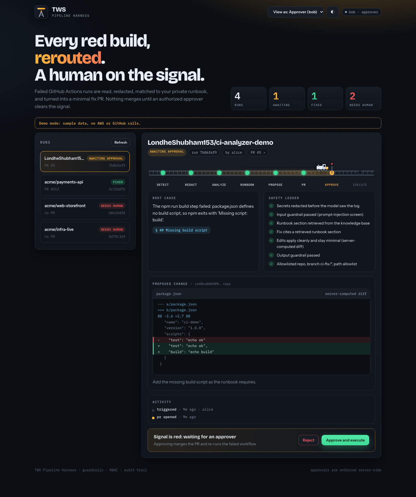
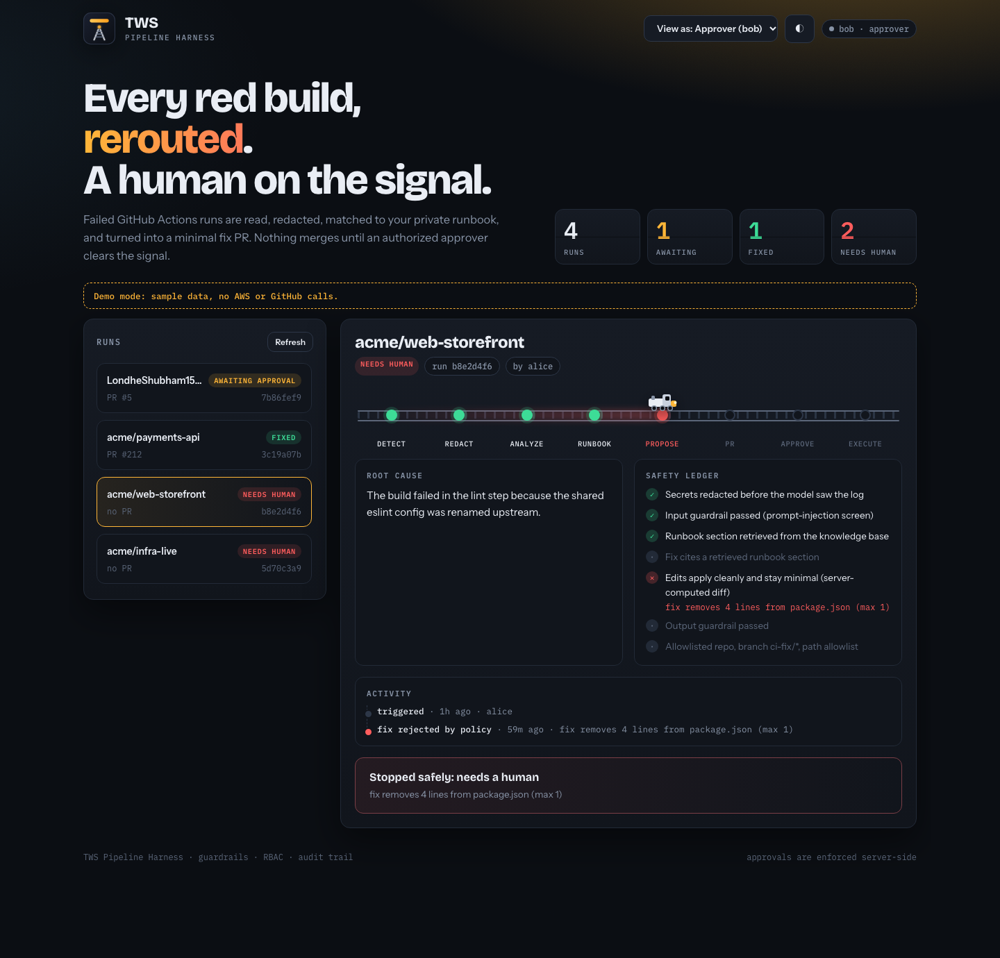
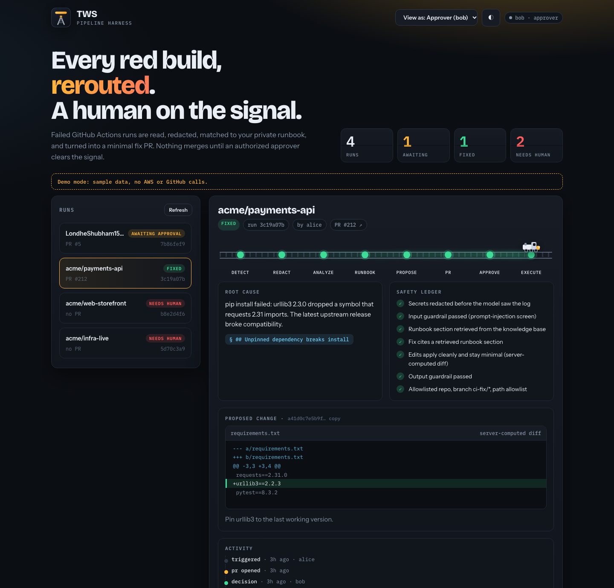
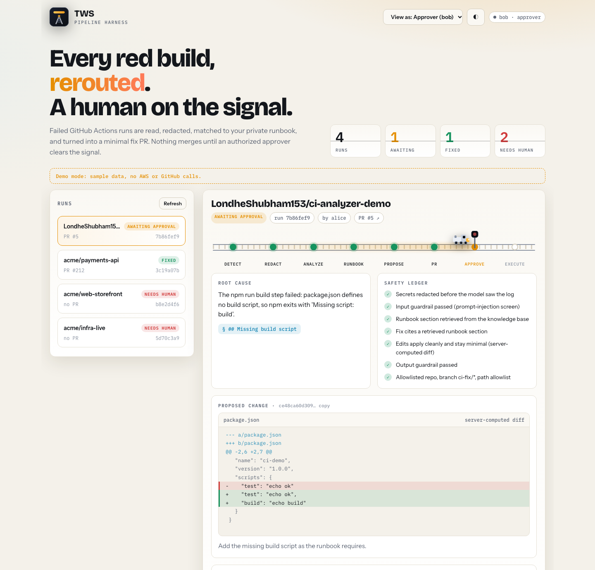
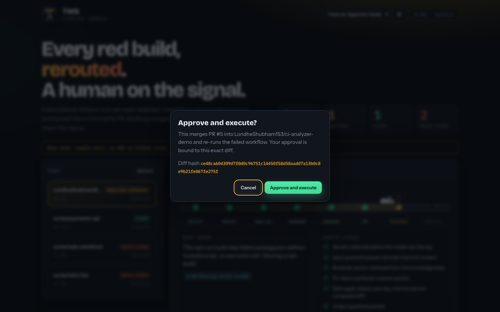
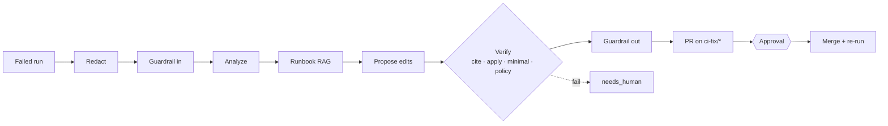

<p align="center">
  
</p>

<h1 align="center">TWS Pipeline Harness</h1>

<p align="center">
  <b>Every red build, rerouted. A human on the signal.</b><br>
  A failed GitHub Actions run goes in. A runbook-backed, minimal fix PR comes out.<br>
  Nothing merges until an authorized approver clears the signal.
</p>

<p align="center">
  
  
  
  
  
</p>

<p align="center">
  <br>
  <sub>Demo data. The train stops at the red signal until an approver acts. Try it: <code>make demo</code></sub>
</p>

---

## Why this exists

CI breaks for boring reasons: a missing script, an unpinned dependency, a deprecated action. Fixing them is toil, and letting
an LLM push to your repos unattended is a bad idea. This project is the middle path, built as a **harness**: the model is one
replaceable part, and everything that makes the result safe lives in deterministic code around it.

## Harness engineering: the model is the least trusted part

> *Agent = model + harness.* The model proposes. The harness decides what is allowed to happen.

| Layer | What it does here | Code |
|---|---|---|
| **Guides** (feed-forward) | Logs declared untrusted. Runbook is the only source of fix authority. The model sees the current file and must answer in a strict find/replace schema. | `graph.py` |
| **Sensors** (feedback) | Secret redaction. Bedrock Guardrails on input and output. Citation must match a *retrieved* runbook source. Edits must match exactly once. Max 1 removed line. Repo / branch / path / size policy. | `guard/`, `graph.py` |
| **Computed truth** | The server applies the edits and computes the diff and its hash. Model-written diffs are discarded. | `graph.py` |
| **Gate** | `interrupt()` before execution. Approval needs a verified Cognito JWT, the `approver`/`admin` group, a different person than the triggerer, and the exact diff hash. | `auth/`, `graph.py` |
| **State & audit** | LangGraph checkpoints, run index and an append-only audit trail in DynamoDB, so any session can resume any run. | `runindex.py`, `audit.py` |
| **Fail closed** | Guardrail error, no runbook match, bad JSON, policy violation: the run ends as `needs_human`, never as a PR. | everywhere |

### What building it taught us (each became a test)

| What went wrong | Control it produced |
|---|---|
| Nova Pro rewrote `package.json`, renamed the package and deleted the `test` script | Model returns edits; **server** applies and diffs; removed-lines cap |
| The "diff" the model reported was its own description of its change | Diff and hash computed server-side |
| Model cited `## Missing build script` (with hashes); the runtime failed to match | Citation normalized **and** verified against retrieved text |
| Approver in a second AgentCore session saw nothing: sessions are isolated per identity | State and run index moved to DynamoDB |
| Container crashed at boot: the secret had no value | Write-only secret in Terraform, boot-time failure now documented |
| Default model id did not exist; Anthropic models blocked by account billing | Model id is config; verified against `ListInferenceProfiles` |

## The UI

A railway control room: the pipeline is a track, each stage a station, and the approval is the signal gate.

<table>
<tr>
<td width="50%"><br><sub><b>Stopped safely.</b> The policy rejected a fix that removed too many lines. No PR was opened.</sub></td>
<td width="50%"><br><sub><b>Fixed.</b> Approved by a different user, merged, workflow re-run, every step in the audit trail.</sub></td>
</tr>
<tr>
<td><br><sub><b>RBAC in the UI.</b> A viewer sees everything and can approve nothing. The server enforces it regardless.</sub></td>
<td><br><sub><b>Light theme</b>, same harness. Respects <code>prefers-color-scheme</code> and <code>prefers-reduced-motion</code>.</sub></td>
</tr>
<tr>
<td><br><sub><b>Confirm with the diff hash.</b> Approval is bound to the exact change.</sub></td>
<td align="center"><br><sub><b>Mobile.</b></sub></td>
</tr>
</table>

<sub>Screenshots use the built-in demo mode (<code>?demo=1</code>): sample data, no AWS or GitHub calls. Live data looks the same.</sub>

## Quickstart

```bash
git clone <this repo> && cd github-actions-ci-analyzer
make install
make demo          # UI with sample data → http://localhost:8777/?demo=1  (switch persona: approver / viewer / admin)
make preview       # full local stack with fake model + fake GitHub + stub login → http://localhost:8765
make test          # 47 tests, no network, no AWS
```

## How a run works



More diagrams, the approval sequence and design decisions: [`docs/ARCHITECTURE.md`](docs/ARCHITECTURE.md).

## API

One endpoint, because AgentCore forwards only `/invocations` and `/ping`. Every call needs `Authorization: Bearer <Cognito access token>`.

```http
POST /invocations
{"action": "trigger",  "repo": "owner/repo", "run_id": 123}        # admin
{"action": "list"}                                                  # any role
{"action": "get",      "id": "<run id>"}
{"action": "audit",    "id": "<run id>"}
{"action": "decision", "id": "<run id>", "approved": true, "diff_hash": "<hash>"}   # approver/admin, not the triggerer
```

| Role | read | approve | trigger |
|---|:-:|:-:|:-:|
| viewer | ✓ | | |
| approver | ✓ | ✓ | |
| admin | ✓ | ✓ | ✓ |

## Configuration

| Variable | Default | Meaning |
|---|---|---|
| `BEDROCK_MODEL_ID` | `us.anthropic.claude-sonnet-5-5` | Converse-capable inference profile |
| `GITHUB_REPO_ALLOWLIST` | none | comma-separated `owner/repo` the agent may touch |
| `GITHUB_TOKEN_SECRET_ID` | none | Secrets Manager id of the fine-grained PAT |
| `KNOWLEDGE_BASE_ID` | none | Bedrock Knowledge Base over the runbook bucket |
| `GUARDRAIL_ID` / `GUARDRAIL_VERSION` | none | numbered version required; `DRAFT` is refused |
| `STATE_TABLE` | none | DynamoDB table (checkpoints, run index, audit). Unset = local SQLite, dev only |
| `COGNITO_USER_POOL_ID` / `COGNITO_CLIENT_ID` / `COGNITO_DOMAIN` | none | auth |

Policy knobs (`config.py`): `branch_prefix=ci-fix/`, `allowed_paths`, `max_diff_lines=200`, `max_removed_lines=1`.

## Deploy on AWS AgentCore

Terraform in [`infra/terraform`](infra/terraform) creates Cognito (MFA, role groups), the runbook bucket and Knowledge Base (S3 Vectors),
Guardrail (pinned version), DynamoDB state, ECR, the least-privilege runtime role and the AgentCore runtime with Cognito JWT inbound auth,
plus the hosting stack (private S3 + CloudFront + proxy Lambda). Step by step, rotation, incident response and costs: [`docs/OPERATIONS.md`](docs/OPERATIONS.md).

## Status (what is verified, what is not)

> **The AWS stack is currently torn down** (`terraform destroy`, 2026-11-15). Everything below was verified while it was up. Redeploy with [`docs/OPERATIONS.md`](docs/OPERATIONS.md).

| | Status |
|---|---|
| Unit and integration tests | **47 passing**, 86% coverage, `ruff` clean |
| Full loop on a deployed AgentCore runtime (real GitHub, Bedrock, Knowledge Base, Guardrails, Cognito JWT, DynamoDB state) | **Verified live**: failed run, PR, approval by a different user in a different session, merge, workflow green. Self-approval and missing-token calls were refused by the live runtime. |
| Model used live | Amazon Nova Pro (the AWS account could not call Anthropic models: billing). Switch with `model_id` once enabled. |
| Persistent audit trail, `audit` action, security headers | Deployed and exercised (runtime image v10) |
| Hosted UI (CloudFront + proxy Lambda), strict CSP/HSTS | Deployed and verified with curl: assets, headers, config, proxy 401/400, authenticated list through the proxy |
| Cognito hosted-UI login in a real browser | Redirect verified (302 to the login page); the interactive sign-in + MFA enrollment flow was **not exercised end to end** |
| Prompt-injection red-team set, retrieval golden eval, CloudWatch alarms | Not done |
| GitHub credential | Use a fine-grained PAT or GitHub App scoped to the allowlisted repos. The live verification used a broad personal token, which should be rotated. |

Security model and known limitations: [`SECURITY.md`](SECURITY.md).

## Repository map

```
src/agent/        graph.py (the harness) · guard/ (redact, policy, bedrock) · auth/ · github/ · rag/ · api/ · audit.py · runindex.py
ui/               index.html · style.css · app.js · logo assets (no build step; strict-CSP friendly)
infra/terraform/  Cognito · KB · Guardrail · DynamoDB · ECR · AgentCore runtime · S3 + CloudFront · proxy Lambda
infra/bff/        the proxy Lambda
runbooks/         sample runbook (the only source of fix authority)
scripts/          e2e_demo.py (real GitHub run) · ui_preview.py · create_user.py
tests/            47 tests, no network
docs/             ARCHITECTURE.md · OPERATIONS.md · screenshots/
```

## Credits

Built by TrainWithShubham. The mark is a signal gantry over perspective rails: a **T** you can only read by following the track.
