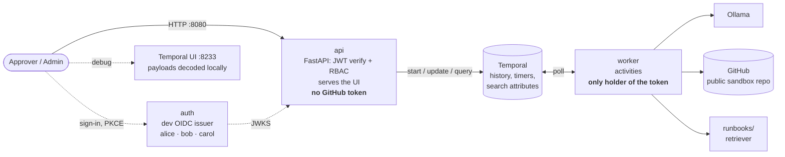
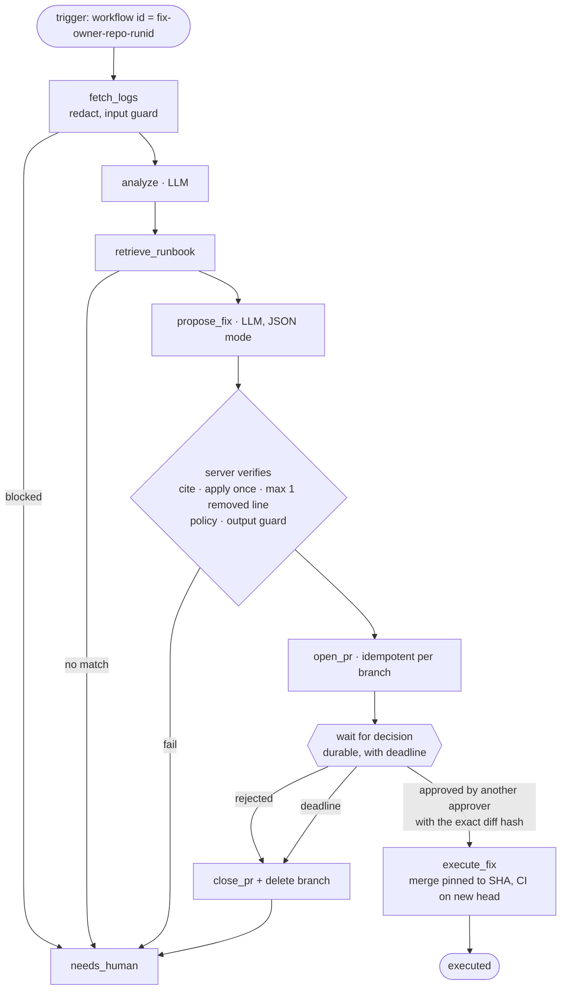
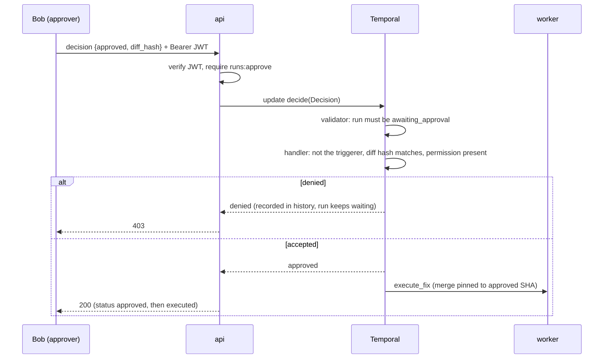

# Architecture

The model is the least trusted part. Temporal is what makes the whole run durable. Deterministic code decides what may happen.

## Components (local profile, `./start_local.sh`)

Everything binds to `127.0.0.1`. Payloads in Temporal history are encrypted (Fernet); the key lives only in the api and worker.

## One run = one workflow

Failure policy: transient errors (network, 5xx, 429) retry with backoff inside Temporal. Permanent errors (4xx, allowlist) are non-retryable and end the run as `needs_human`. If a PR already exists, the saga closes it. Guard blocks, policy violations and unusable model output are **results**, not exceptions.

## Approval

## Design decisions

| Decision | Why |
|---|---|
| Temporal instead of LangGraph checkpoints | Checkpoints save state; nothing resumes a crashed run. Temporal replays the workflow on any worker, retries each step, and times out the human wait. |
| Workflow code has no I/O | Replay must be deterministic. All side effects live in activities, so a retry never repeats a decision. |
| Denied approvals do not end the run | A viewer's mistaken click must not kill a run an approver is about to approve. Every attempt is an audit event. |
| Approval bound to the diff hash, merge pinned to the head SHA | What was reviewed is exactly what merges. |
| "Re-run" dispatches a fresh run on the branch | GitHub's re-run replays the original (broken) commit. Found by the live test. |
| API holds no GitHub token | The api can be exposed to users; only the worker can touch GitHub. |
| Encrypted payloads + codec endpoint for the Temporal UI | History is a data store: it must not hold CI log excerpts in clear text, yet stay debuggable locally. |
| One `/invocations` endpoint | Same contract as AgentCore, so the AWS profile keeps working with the same UI. |
| Dev OIDC issuer, same verifier | The local demo exercises real JWT verification (signature, issuer, client, expiry), not a header toggle. |

## Data

| Where | What | Sensitive? |
|---|---|---|
| Temporal history | step inputs/outputs: redacted log tail, analysis, runbook excerpts, diff, PR info, audit events | Encrypted with `CODEC_KEY` |
| Search attributes | `CiStatus`, `CiRepo`, `CiTriggeredBy` | Plain (used for listing); no content |
| `.secrets/github_token` | GitHub token (Docker secret) | Yes. Mounted only into the worker and the seed helper. |
| `.env` | repo name, model, encryption key | Key is sensitive; gitignored |

## AWS profile (adapters kept, infra not updated)

`BedrockLLM`, `BedrockKBRetriever`, `BedrockGuard` and `CognitoVerifier` are still wired behind the same seams. The Terraform in `infra/terraform` predates Temporal: deploying it needs a Temporal endpoint and a Fargate worker, which this repo does not yet provide.
