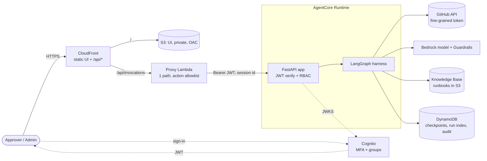
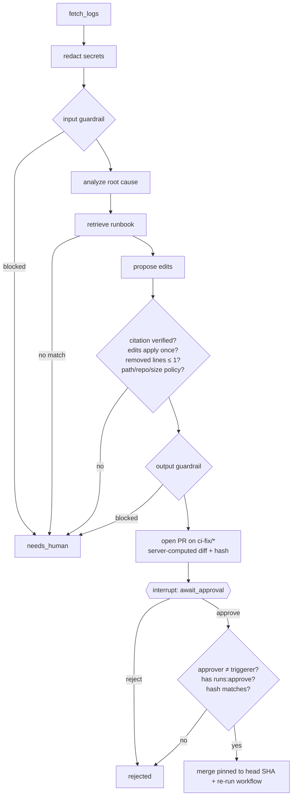
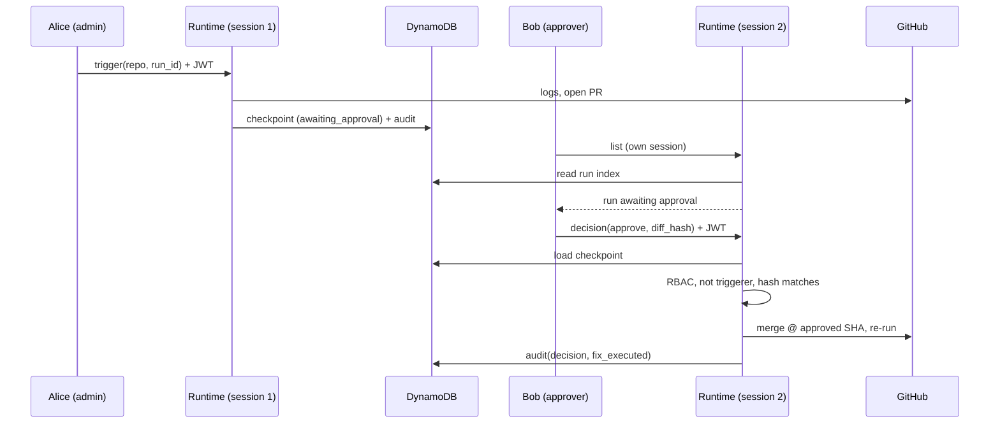

# Architecture

## Components

## The harness (one run)

## Approval sequence

## Design decisions

| Decision | Reason |
|---|---|
| **Find/replace edits, applied and diffed server-side** | A weaker model rewrote and reformatted whole files. The server, not the model, defines what changed. |
| **State in DynamoDB, not in the runtime** | AgentCore sessions are isolated microVMs bound to one identity; approvals cross users. |
| **One `/invocations` endpoint with actions** | AgentCore forwards only `/invocations` and `/ping`. Same RBAC for every action. |
| **Proxy Lambda instead of calling AgentCore from the browser** | The runtime does not serve CORS; the proxy keeps the UI same-origin and narrows the surface. Auth `NONE` on the function URL is deliberate (CloudFront OAC would overwrite the user's `Authorization` header). |
| **Citation must match a retrieved source or a real `##` heading** | The model cited `## Heading` (with hashes) and plain names; we normalize but still verify against retrieved text. |
| **Fail closed everywhere** | Guardrail error, no runbook match, unparseable model output, policy violation: all end in `needs_human`, never in a PR. |
| **Ephemeral write-only secret in Terraform** | `secret_string_wo` keeps the token out of state. |

## Data

| Store | Keys | Contents |
|---|---|---|
| DynamoDB `*-state` | `CHECKPOINT_*`, `CHUNK_*`, `WRITES_*` (LangGraph) | graph state per run (redacted logs, analysis, proposal, PR) |
| | `PK=RUNS`, `SK=<run id>` | run index |
| | `PK=AUDIT#<run id>`, `SK=<ts>#<nonce>` | audit events (ids, actors, decisions, reasons) |
| S3 runbooks | `*.md` | the only source of fix authority |
